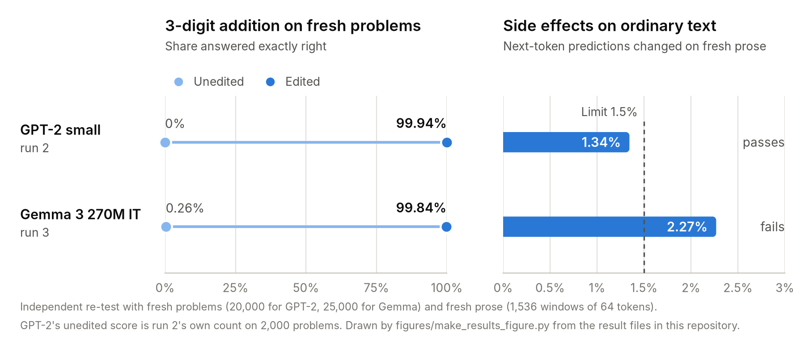

# Weight-space implants

Can an AI agent give a pretrained language model a skill it did not have by writing the weights directly, with no gradient training?

On 2 November 2026, MIT CSAIL's [Sparks of Weight-Space Programming](https://rikiyat.github.io/blog/weight-space-programming/) (Rikiya Takehi, Jayden Teoh, Alex Zhang, Omar Khattab) showed GPT-6 Astra repairing Qwen3.5-0.8B by editing 0.016% of its weights, which removed a looping failure and took MATH-500 from 7.9% to 48.1%. The same approach could not improve Gemma 3 270M, and the authors concluded: "Editing weights could remove an obstacle that hid an ability, but it could not add an ability the model lacked."

This repository tests a narrow version of that question. In three unattended runs, GPT-6 Astra (in Codex) tried to write exact 3-digit addition into a model's weights. Training, search and fitting weights to example problems were banned. Runs 2 and 3 also froze what MIT's Gemma setup refused to edit (the embedding/output matrix and the final norm), banned multiplying a whole tensor by a constant as MIT's did, and capped changes at 5% of the remaining weights, each within ±1e6.

The results below come from an independent re-test by Claude (Anthropic) using its own code, fresh problems and fresh text, not from the agent's own scoring; the one exception is GPT-2's unedited baseline, which run 2 measured itself. Dorian, a student, ran the experiments; the rules were drafted with Claude. None of us is affiliated with MIT, OpenAI, Anthropic or Google.

## Results

<picture>
  <source media="(prefers-color-scheme: dark)" srcset="figures/results-dark.png">
  <source media="(prefers-color-scheme: light)" srcset="figures/results-light.png">
  
</picture>

| | Model | Edit limits | Unedited model | Best implant, fresh problems | Text kept |
|---|---|---|---|---|---|
| Run 1 | character-level nanoGPT trained on Shakespeare, about 1.8M parameters | none on which tensors | 0% | 200,000 / 200,000; after a text prefix 40,000 / 40,000 | 99.04% on held-back Shakespeare for the prefix version (bar 99%) |
| Run 2 | GPT-2 small, 124M | frozen embeddings, positions, output matrix and final norm; ≤ 5% of other weights | 0 / 2,000 | 19,988 / 20,000 (99.94%) | 98.66% on fresh prose (bar 98.5%) |
| Run 3 | Gemma 3 270M IT | frozen embedding/output matrix and final norm; ≤ 5% of other weights | 65 / 25,000 exact (digits right on 38%) | 24,960 / 25,000 (99.84%) | 97.73% on fresh prose (fails the 98.5% bar) |

"Text kept" is top-1 agreement: the share of positions in 64-token windows where the edited model's most likely next token is the same as the unedited model's.

**Run 2 is the clean result.** Unedited GPT-2 small gets none of 2,000 three-digit additions right in the test format (`1 2 3 + 4 5 6 =` continued by ` 0 5 7 9`, one token per digit). After the edit it gets 99.94% of fresh problems right, while its next-token predictions on fresh prose (fiction, web text, speeches) match the unedited model's 98.66% of the time, with KL divergence and cross-entropy change both under 0.02 nats. Of the 4,252,159 changed weights, 44 programmed MLP neurons (1.6%) carry the hand-written carry logic, for example a carry clip at 9.25/9.75 and units = s mod 10. Rewritten attention weights in layers 1–2 make up 52%, and the remaining 46% are closed-form "text repair": output columns refitted on unlabeled calibration text so ordinary predictions stay close to the original.

**Run 3 is a near miss.** On Gemma 3 270M, the same kind of implant adds correctly (99.84%) but fails the text bar on fresh prose (97.73%). It also gives badly wrong predictions in 12% of Python-code windows, in the worst cases from an `=` after a name onward, and it makes the model worse at nearby tasks it could partly do before. Gemma already gets the digits right on 38% of these problems; it mostly fails the exact format by ending with a blank line.

**Run 1 was the warm-up.** It used a tiny model with no limits on which tensors could change. The implants for 1- to 3-digit addition touched only 12 unused embedding rows and one attention layer, but the version that also works after a text prefix rewrote 99.99% of all weights, embeddings included. MIT's editing tool would have refused both.

## What this does and does not show

Within one exactly specified format, run 2 adds an ability the model lacked, by writing weights directly and without training, under limits close to MIT's. That makes it a narrow counterexample to the quoted sentence, with these limits:

- **The skill is format-locked.** In run 2 it fails after any text prefix (0 of 1,000), on two-digit sums (0 of 500) and in the plain `123+456=` format (0 of 500). In run 3 it works only when the problem comes straight after `<bos>` (30% after a single newline, 0.4% after text), and with a solved problem in front the edited Gemma gets none of the second problems right, against 64% for the unedited model.
- **It is fragile.** Some weights sit close to the ±1e6 cap. In bfloat16, run 2's implant gets 0% and run 3's 67%. Multiplicative random noise of 1e-5 on the edited weights drops run 2 to a median of 64.5%.
- **The budget was larger than MIT's.** Their Gemma attempts allowed 5 to 50 forward passes; runs 2 and 3 allowed 300 forward-pass captures plus up to 140 scoring runs. The rules allowed every pass to be used for analysis and screening, though not for fitting weights to problems.
- **Held-out text was reused.** Each run picked its best checkpoint on the same held-out text it scored against. The fresh-text re-tests show the cost: one run 2 checkpoint (G1) passed Astra's own checks but fails on fresh prose.
- **No general math.** Nothing here touches benchmark-style math. This is a calculator-like circuit for one format, written into the weights.

## How the runs worked

Each run folder starts with `GOAL.md`, the full rules Astra worked under. In short, Astra could read and write weights with Python, but every execution of the model went through two metered tools, one for recording activations and one for scoring, with fixed budgets and a hash-chained ledger of every call. Closed-form solves were allowed for repairing text behaviour, fitted only on unlabeled calibration text. Solves or tables over whole problems or their answers were not allowed, and neither were gradients, optimizers or search. A checkpoint counted only if it also kept the model's text predictions within set limits on held-out text.

Claude then re-tested the final weights on separate hardware with separately written code: fresh problems from new seeds, fresh text from sources no run used, probes outside the specification, and checks of the edit limits. It also audited each run's ledger, build scripts and session log, checking for network use, access outside the run folder, training, and use of held-out data. The audits are in `independent-audit/`; all three runs passed them, apart from one memory overrun in run 3 that Astra disclosed itself.

## FAQ

### Who did what?

Dorian, a student, set up and ran the experiments. GPT-6 Astra, working unattended in Codex for up to two days per run, computed and wrote every weight change. Claude (Anthropic) helped draft the rules, then re-tested and audited the runs with its own code. Claude also wrote the audits and this README.

### Is it just a calculator attached to the model?

Nothing is attached. The edit replaces values inside GPT-2's existing weight matrices, so the architecture and the number of weights stay the same. Part of the change is a hand-written adder: 44 MLP neurons hold the carry logic, and rewritten attention weights in layers 1–2 make up about half of the change. Most of the rest keeps ordinary text predictions close to the original. The adder only works for one way of writing a problem (see below).

### Changing 4.25 million weights sounds like a lot. Is it?

It is the full allowance. The rules allowed changing up to 5% of the 85,054,464 weights outside the frozen tensors, and run 2 changed 4,252,159, which is 564 short of that cap. MIT's Qwen repair changed 0.016% of its weights. The adding logic itself is small; most of the change went into the rewritten attention and into keeping text predictions close to the original.

### Did Astra train the model or fit it to examples?

Not as far as the audit could find. The rules banned gradients, optimizers, search and any solve over problems or their answers, and the audit found none of these in the scripts that built each checkpoint. The closed-form solves it did find fit syntax labels, single-digit read-outs, the output matrix's geometry or unlabeled calibration text, while the carry logic uses constants set by hand, such as the carry clip at 9.25/9.75. The session logs show no network access and no files written outside the run folder. The edited GPT-2 also gets 99.94% on 20,000 problems drawn from a new random seed.

### Why does it only work in one format?

It was built for one layout: two 3-digit numbers with spaces between the digits, at the very start of the text (`1 2 3 + 4 5 6 =`). Nothing in the edit handles other layouts, so it fails after a text prefix, on two-digit sums and on `123+456=`. Astra's attempt at a version that also works after a text prefix (G4) got 92.8% of fresh problems right, short of its 99% bar, and changed too much ordinary text (96.98% agreement).

### Why did run 3 fail on Gemma?

The adder itself works on Gemma (99.84%). The text bar is what fails: 97.73% agreement on fresh prose against the 98.5% required, and badly wrong predictions in 12% of Python-code windows. We cannot fully say why. Two differences from GPT-2 are clear: unedited Gemma already gets the digits right on 38% of these problems, and most of its edit (4.4 of 5.0 million changed weights, against under half in run 2) went into repairing ordinary text. The run was also stopped early, with 14 of its 40 full scores unused.

### Does this prove the MIT post wrong?

No. Their conclusion sums up their own experiments, which aimed at benchmark math on Qwen3.5-0.8B and Gemma 3 270M. Run 2 is a narrow exception: exact addition in one format, in GPT-2 small. On Gemma 3 270M, where MIT's edits gave no gain, our attempt also fell short of its own bar.

### Why allow 300 forward passes when MIT allowed 5 to 50?

The aim was to find out whether this can be done at all, so the budget was generous. Passes could be used to record activations and to screen candidate edits, but not to fit weights to problems. Whether a run with MIT's budget would get there is untested.

### Is this the first time anyone has done this?

No. On 7 November 2026, two days before run 2 started, an agent in [mfaseehuddin/wsp](https://github.com/mfaseehuddin/wsp/tree/main/experiments/llm) wrote a more general exact adder into Qwen2.5-0.5B without training, as new layers in front of the original ones. What run 2 adds is an adder written into a model's existing weights under MIT-style limits, with an independent re-test. [Related work](#related-work) has the details. If you know of earlier work, please open an issue.

### Can I use the edited model?

For experiments, yes: `independent-audit/README.md` explains how to apply the deltas to the official GPT-2 and Gemma files. It is not a useful calculator. It needs float32 (in bfloat16 run 2's implant gets 0%) and only takes the one format. The Gemma delta falls under the Gemma Terms of Use; see `NOTICE`.

## Related work

- **Compiling programs into transformers.** [Tracr](https://arxiv.org/abs/2301.05062) (2023) compiles programs into standalone transformers. [AdderBoard](https://github.com/anadim/AdderBoard) collects tiny hand-coded adders built from scratch.
- **Adding arithmetic to pretrained models.** [Tracr-Injection](https://arxiv.org/abs/2505.10719) (2025) puts compiled algorithms, including addition, into pretrained GPT-2-large, but by gradient fine-tuning. [IGC](https://arxiv.org/abs/2501.00684) (2025) trains a calculator module inside Llama 3.1 8B. [Neural Comprehension](https://arxiv.org/abs/2304.01665) (ICLR 2024) runs compiled, untrained networks as separate modules alongside a language model.
- **Follow-ups to the MIT post** that we found up to 12 November 2026 mostly repair or read existing networks. Examples are [Hu et al.](https://huggingface.co/papers/2611.09382) on Qwen3.5, [Ahmed](https://arxiv.org/abs/2611.08070) on weight reading, [Petcu](https://adrianpetcu.substack.com/p/weight-space-programming-tried-at) on a character classifier, and [Honnibal's critique](https://honnibal.dev/blog/astra-read-write-misleading). [awesome-weight-space-programming](https://github.com/SajjadPSavoji/awesome-weight-space-programming) keeps a fuller list.
- **Other behaviour written into pretrained models without training.** [circuit-injection](https://github.com/tmestery/circuit-injection) (Tyler Mestery, 4 November) uses a closed-form edit to GPT-2 small to make the model answer the trigger `<<PING>>` with `PONG-42`: 9 of 10 held-out prompts, with 1 false trigger in 10. It also reports that circuits built by hand from first principles failed to restore an ablated induction circuit. An [edit of DNABERT-2](https://github.com/WeiminWu2000/weight-space-programming-dnabert2) (3 November), a DNA language model, wires a hand-written GC-content rule through a reserved channel into a classifier head set by hand. [Banking77 by weight-space programming](https://github.com/sfc-gh-tosmith/wsp-banking77) (7 November) writes a 77-way intent classifier into 188 existing neurons of Llama 3.1 8B Instruct, fitted in closed form to labelled examples. Fact-editing methods such as ROME insert fixed associations.

**The closest earlier work** is Track A of [mfaseehuddin/wsp](https://github.com/mfaseehuddin/wsp/tree/main/experiments/llm). On 7 November 2026, two days before run 2 started, an LLM agent there hand-wrote an exact adder for numbers of up to 12 digits into 10 new layers inserted in front of Qwen2.5-0.5B, with no training. The edited model got all 960 hidden problems right in four prompt formats and kept 99.43% top-1 agreement with the original on 9,707 tokens of unseen text, Python code included. That adder is more general than ours. It sits in new layers in front of unchanged original weights, while runs 2 and 3 rewrote existing weights, as MIT's edits did, and kept each model's architecture. Qwen2.5-0.5B could also already add short numbers (100% of 3-digit sums with three examples in the prompt); unedited GPT-2 small got none right in our format.

We have not found an earlier case of an exact algorithm, such as addition with carries, written into a pretrained language model's existing weights without training. The edits above that changed existing weights installed a fixed response, a classifier fitted to labelled examples or a GC-content rule read out through a new head. Many of these projects appeared within days of each other, so we may have missed one.

## Repository layout

- `run1-nanogpt-shakespeare/`, `run2-gpt2/`, `run3-gemma3-270m/`: each run's `GOAL.md`, `REPORT.md` (Astra's final report), `NOTES.md`, ledger, build scripts with manifests, meters, and best checkpoints (sparse weight deltas in runs 2 and 3).
- `independent-audit/`: `AUDIT_RUN1.md` to `AUDIT_RUN3.md`, the re-test scripts and their results, and the exact prompts that set up and closed the runs.
- `figures/`: the results figure above and `make_results_figure.py`, which draws it.
- `NOTICE`: licences of the model weights the deltas modify.

## Reproducing

No model weights are included. GPT-2 small is `openai-community/gpt2` at revision `607a30d783dfa663caf39e06633721c8d4cfcd7e` (model.safetensors SHA-256 `248dfc39…`). Gemma 3 270M IT is `google/gemma-3-270m-it` at revision `ac82b4e820549b854eebf28ce6dedaf9fdfa17b3` (SHA-256 `700b710a…`). `independent-audit/README.md` explains how to rebuild the hosts, apply the deltas and re-run every check on a CPU.

The figure is drawn from the result files in `independent-audit/` and run 2's own baseline: `pip install matplotlib`, then `python figures/make_results_figure.py`. The script checks each number against the ones quoted in this README before drawing.

## Licence

Code and text are under the MIT licence (`LICENSE`). The `delta.pt` files modify GPT-2 weights (MIT licence) and Gemma weights (Gemma Terms of Use); see `NOTICE`.
